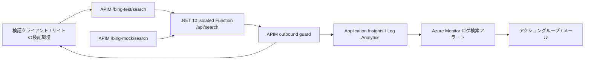

# 実装仕様・PDF との対応

対象：2026 年 11 月 5 日付「Bing Custom Search 障害時対策」の提示資料。
本書は資料を実行可能な検証用構成に落としたものであり、本番パラメーターの承認や本番環境への適用完了を意味しません。
お客様の追加要望により、PDF の日英切替は採用せず、障害案内のタイトル・本文を英語に統一しています。

## 1. 成果物

| PDF | 要件 | 対応ファイル |
|---|---|---|
| p.3–14 | 全件判定、HTTP 200 の 1 件置換、3 モード。追加要望で英語のみ・6 設定値に簡素化 | [inbound fragment](../apim/fragments/bing-guard-inbound.xml)、[outbound fragment](../apim/fragments/bing-guard-outbound.xml) |
| p.14 | 既存 API への include 2 行 | [UI 手順書の本番移行手順](./portal-step-by-step.ja.md#13-本番移行切り戻し) |
| p.16–19、29 | 検知 trace / metric、調査と通知 | [アラート KQL](../monitoring/guard-alert.kql)、[調査 KQL](../monitoring/guard-investigation.kql)、[UI 手順書](./portal-step-by-step.ja.md) |
| p.20–22、30 | モック、製品別の確認、テスト用 API | [.NET Function](../src/functions/Search.cs)、[応答生成](../src/MockSearch.cs)、[APIM Bicep](../infra/apim.bicep) |
| p.23 | 設定変更、緊急停止、運用手順 | [UI 手順書](./portal-step-by-step.ja.md) |
| p.26 | 正式値の確定 | 下記「承認待ちの設定」 |

### 構成

Function は外部検索を呼び出しません。`BingAPIs-TraceId` は検証用に生成した GUID であり、
実際の Bing 障害調査には使用できません。本番は既存 Bing 応答の同ヘッダーを記録します。

## 2. .NET Function

- .NET 10 / Azure Functions v4 / isolated worker。`Azure.Functions.Sdk` を使用。
- `GET /api/search`、`AuthorizationLevel.Function`。
- `q` を `queryContext.originalQuery` に保存。
- `x-mock-scenario` で応答を切り替え。互換用 `scenario` クエリも利用可能で、ヘッダーを優先。
- 未指定は `good`。不明なシナリオは 400。APIM も 400 を維持します。
- `MOCK_ALLOWED_DOMAIN=panasonic.jp`、`MOCK_EXCEPTION_DOMAIN=exceptions.example` が既定値。
- 全応答に `Cache-Control: no-store`、`X-Mock-Response: true`。
- 本番 API で故障注入ヘッダーを利用する構成にはしません。

## 3. 判定契約

### 検査対象

HTTP 200、`application/json`、非空の `webPages.value` 配列のみ。
`webPages.value[].url` と各結果の `deepLinks[].url` を検査します。

URL は絶対 HTTP(S) URL として解析し、大小文字と末尾 DNS ドットを正規化したホスト名を使用します。
userinfo、空文字、相対 URL、制御文字、空白、曖昧なバックスラッシュ、欠落/数値 URL は異常です。
パスやクエリに含まれるキーワードでは許可しません。IPv4/IPv6 は設定に合わないため通常拒否されます。

許可条件は OR です：

1. ホスト名が設定キーワードを **部分一致** で含む。
2. ホスト名が設定ドメインと一致、または `.` 境界付きサブドメイン。

従って `panasonic-campaign.example.com` は既定のキーワード設定で許可されます。
これは PDF p.8–9 の仕様で、所有権を保証するセキュリティ境界ではありません。
強化時はキーワードを空にし、正式な許可ドメインを列挙します。ドメインだけの設定でも子ドメインを許可します。

### 各モード

| 状態 | HTTP / 本文 | X-Bing-Guard | 検知ログ / 指標 |
|---|---|---|---|
| off | 元応答 | 追加しない | なし |
| 全件許可 | 元応答をそのまま保持 | pass | なし |
| monitor、異常あり | 元応答本文をそのまま保持 | detected-monitor-only | あり |
| enforce、異常あり | HTTP 200、障害案内 1 件 | blocked | あり |
| 対象外応答 | 元ステータス / 元本文 | skipped | `BingGuardSkipped` のみ |
| モード/許可リスト/案内 URL 設定不正 | 500、設定エラー JSON | 規定しない | `BingGuardConfigurationError` |

対象外：非 200、非 JSON、解析不能 JSON、トップレベル配列、`webPages` なし、
空結果、想定外の `webPages.value` 形式。対象外を成功扱いして隠すのではなく、skip 理由を trace に記録します。
skip trace は error 詳細度でも確認できるよう severity=error ですが、障害通知用 KQL には含めません。
大量の空結果もログになります。導入時にログ量を評価してください。

JSON 解析の catch は `Source == Newtonsoft.Json` の例外に限定しています。
APIM の許可型に含まれない個別例外型への依存を避けるためで、他の実行例外は隠しません。
接続失敗/タイムアウトは既存 APIM エラー処理を維持します。200 の案内には変換しません。

### 置換本文

- 新しい `SearchResponse` を生成し、元の外部結果を部分的に残しません。
- `queryContext` と `webPages.webSearchUrl` は存在する場合に保持。
- `totalEstimatedMatches=1`、`value` はちょうど 1 件。
- `id/name/url/displayUrl/snippet/dateLastCrawled/language/isFamilyFriendly/isNavigational` を生成。
- `rankingResponse` が元にある場合のみ、`mainline.items` を 1 件・`resultIndex=0` に再構成。
- 画像、deepLinks、元 ranking の外部参照、他の結果セクションは置換本文に含めません。
- タイトル・本文は英語のみ、`language=en` 固定。`mkt` / `setLang` による言語切替は行いません。
- `Cache-Control: no-store` に変更し、元の Content-Encoding / ETag / Last-Modified は削除。

`webSearchUrl` は PDF の互換要件で保持する表示用フィールドであり、許可対象 URL には数えません。
画像/news/videos 等も独立した検査対象ではありません。通常通過時はそれらを含む元 JSON を保持します。
従来の厳格な「すべての URL フィールドを検査する 502 ガード」とは異なります。

## 4. 承認待ちの設定

ガード用 Named Values は英語統一により 6 個です。検証モックの接続用 Secret は別に 1 個あります。

| 名前 | 検証値 | 本番での確認 |
|---|---|---|
| bing-guard-mode | monitor | monitor → enforce の承認 |
| bing-guard-allowed-keywords | panasonic,technics | 部分一致リスクを承認 |
| bing-guard-allowed-domains | exceptions.example | **正式な例外 2 ドメインへ変更** |
| bing-guard-sorry-title | Search is temporarily unavailable | 文言承認 |
| bing-guard-sorry-snippet | We apologize for the inconvenience. Please try again later. | 文言承認 |
| bing-guard-sorry-url | https://www.panasonic.com/ | **承認済み案内ページへ変更** |

既存環境の更新時は、まず接尾辞なしの `bing-guard-sorry-title` / `bing-guard-sorry-snippet` を作成し、
承認済みの英語文言を設定してから outbound fragment を更新します。
他の API / fragment の参照がないことを確認した後、旧言語別 Named Values を削除できます。
Bicep の通常の増分デプロイでは旧 Named Values を自動削除しません。
パラメーターファイルを使用している場合は `sorryTitle` / `sorrySnippet` に合わせて更新してください。

- 値を C# 文字列として使うため、半角 `"`、バックスラッシュ、CR/LF、`@(`、`@{`、`{{`、`}}` を含めないでください。
  これは管理者による設定値の制約です。任意文字列を安全に入力できる文言 CMS ではありません。
- ドメインは ASCII/Punycode の DNS ホスト名。スキーム、パス、`*.`、IP を指定しません。
- `allowed-keywords` と `allowed-domains` は片方を空にできます。両方空なら構成エラー。
- 空値を Portal で保存できない場合、単一の半角スペースを保存すると空設定として扱います。
- モックと例外リストを別の値へ変更するときは、Function のアプリ設定も合わせます。
- 正式な通知先メール、作成先サブスクリプション/RG/リージョン、保持期間、通知重要度も承認が必要です。

## 5. 監視

検知時の `trace.message=BingGuardTriggered` と補助メトリック `BingGuardTriggered` を 1 回発行します。
trace は APIM リクエストサンプリングの対象外ですが、API の診断設定と Application Insights の受信が前提です。
サンプリング対象外であることは、メール送達や欠損ゼロの保証ではありません。

メタデータ：
`guardMode / bingInstance / productName / subscriptionName / bingTraceId / violatedHosts / market / searchQuery / apimRequestId`。
`mkt` は任意です。未指定・空文字・空白のみの場合、`market=unspecified` と記録します。
同様に検索語が空なら `searchQuery=unspecified`、`customconfig` が空ならログとメトリックの
インスタンスを `unknown` とし、APIM が必須とするメタデータ値を空にしません。
これはログの欠損表現のみで、リクエストへの `mkt` の追加や検索条件の変更は行いません。
APIM のクエリ値に `%20` や `+` が残る場合も、空白判定時にだけデコードします。
空白以外の元の値は維持し、二重デコードはしません。
この修正はローカル 495 assertions と実 APIM の 7 ケース
（未指定・空・エンコード済み空白・`+` 空白・日英市場・全任意項目なし）で確認済みです。
テスト環境の outbound fragment に反映済みで、Sampling と動作モードは変更していません。
違反ホストは重複なし最大 10 件。無効 URL は `[invalid-url]` とし、URL 全文や資格情報は記録しません。
検索語は先頭 100 文字を記録します。個人情報・機密情報の方針に応じて `searchQuery` 要素を削除してください。
クエリ文字列自体が通常の APIM request telemetry に残る場合もあるため、診断設定側も確認します。

インスタンスは `customconfig`、製品は `context.Product.Name` です。
API-scoped / all-APIs のキーでは Product が空になり `unassigned` となるため、
製品別検証では必ず **Product A / B に属する専用サブスクリプション** を使います。
API revision 名ではなく実際の `customconfig` を使用し、ヘッダー等でキー本体をログ出力しません。

アラート：直近 5 分、5 分ごと、結果行数 > 0、`BingInstance × ProductName` で分割、
通知アクションを 1 時間抑止。厳密なメール最大件数はアラート状態/再発/遅延にも依存するため実機で確認します。
KQL は Application Insights スコープの `traces` 向けです。
Workspace スコープで実行する場合は `AppTraces / TimeGenerated / Message / Properties` に読み替えます。

## 6. 適用範囲と制約

- Bicep は **既存 APIM/Function App** 内のテスト API、backend、Secret、6 設定値、2 fragments のみ。
  RG、Function App、APIM、Insights、Workspace、製品、サブスクリプション、アラートは UI 手順で作成します。
- 既存サンプルの API ID `bing-domain-guard` は維持しますが、パスは `/bing` から `/bing-test` に変更します。
  既存呼び出し元を確認してから適用してください。旧 Named Values は自動削除しません。
- 正常応答の本文は `preserveContent: true` で保持します。ヘッダーには診断マーカーを追加します。
- 遅延が数 ms 以内になるとは保証しません。本文全体をバッファリングするため、実レスポンスサイズで計測が必要です。
- 圧縮、親/操作 policy、cache-lookup の早期応答、cache-store、on-error の実動作はローカル harness では再現しません。
- HTTP の Content-Length は APIM の set-body が再計算します。テストコンソールで転送本文と整合を確認してください。
- モックのクエリパラメーター/シナリオは検証専用。ユーザー入力で許可リストやモードを変更する機能はありません。
- URL の先へアクセスせず、リダイレクトを追跡せず、ページ本文を検査しません。
- ソース PDF の共有や複製は成果物に含めません。

## 7. 検証レイヤー

1. `dotnet test`：モックの応答、故障シナリオ、Function 属性を検証。
2. [Test-Policy.ps1](../test/Test-Policy.ps1)：実際の fragment 内 C# 式と XML 分岐を読み込み、
   pass/skip/off/monitor/enforce、完全な本文保持、単一結果/ランキング/英語固定、
   ドメイン境界と deepLinks、ログ項目を検証。
3. 同スクリプトの `-FunctionBaseUrl`：起動済み実 Function の HTTP 応答へ、同じガードを適用。
4. APIM Test UI：実 gateway の型制限、ルーティング、継承、telemetry、メール、サイトの表示を検証。

1–3 が成功しても 4 の代替にはなりません。クラウドの確認結果と承認は UI 手順書の記録欄へ記入してください。

### ローカルで確認済み（2026-11-10）

- .NET ビルド / 単体テスト：22 件成功。
- 英語統一後の実際の fragments の式・分岐：365 assertions 成功。
  日本市場・`setLang=ja` でもタイトル・本文・`language` が英語固定であることを確認。
- 初回構成では Core Tools 4.15.2 で実 .NET Function を起動し、19 種類の HTTP 応答を含む
  401 assertions 成功。
- VS Code 公開タスクと同じ Release publish が成功。
  公開先の host.json / .azurefunctions / worker.config.json を確認し、テストとローカル設定は含まれないことを確認。
- APIM Bicep のコンパイル成功。診断 ARM テンプレートの JSON と本文記録 0 bytes 設定を確認。
- ローカル Storage 未設定によるホストの Storage health 警告は残りますが、HTTP 応答テストは成功。
  Azure の作成手順では実 Storage を設定します。

### Azure 実環境で確認済み（2026-11-10）

- 専用 RG：`rg-bing-guard-demo-20261110`、Japan East。既存環境は変更していません。
- Function：`func-bing-guard-261110-844b`、.NET 10 isolated、Flex 512 MB、最大 5 インスタンス。
- APIM：`apim-bing-guard-261110-844b`、Consumption。
- ガード付き：[テスト API](https://apim-bing-guard-261110-844b.azure-api.net/bing-test/search)。
- 比較用：[無ガードのモック API](https://apim-bing-guard-261110-844b.azure-api.net/bing-mock/search)。
- 両 API に製品 A/B のサブスクリプションキーが必要です。キーは Portal で確認し、文書に保存しません。

| 実 gateway の確認 | 結果 |
|---|---|
| good / subdomain / exception / lookalike | 200、pass、元の 2 件 |
| mixed / all-bad / deep-link / 不正 URL 等 | 200、blocked、英語案内 1 件 |
| mkt=ja-JP / setLang=ja | 英語固定、language=en |
| 空結果・非 JSON・解析不能 JSON・想定外形式 | 200、skipped、元本文 |
| upstream-error | 元の 500、skipped |
| monitor / mixed | 200、detected-monitor-only、元の 3 件 |
| off / mixed | 200、ガードヘッダーなし、元の 3 件 |
| 無ガード API / mixed | 200、元の 3 件 |
| Product A/B、instance a/b | 正しい製品・サブスクリプション名で検知ログ |
| 未認証リクエスト | Function / APIM とも 401 |

[Test-Apim.ps1](../test/Test-Apim.ps1) の **24 ケースが成功**。最終モードは **enforce**。
実 APIM の式制限に合わせ、catch の例外フィルター構文を除去し、
許可されない `UriKind` を使わず絶対 URL を解析するよう修正済みです。

検知 trace の初回集計は 18 件で、Bing TraceId をすべて保持。
`BingGuardTriggered` カスタムメトリックの合計も 18 を確認。
2026-11-10 08:03:19 UTC に実際のログアラート 3 件が **Fired** になりました。
5 分評価・5 分参照・1 時間アクション抑止と、指定先のメール Action Group を有効にしています。
**受信箱へのメール到着と、1 時間全体の抑止・再通知周期は未確認**です。
各サイトの UI 表示確認も担当者による別途確認が必要です。

#### 今回のテスト環境固有の例外と費用

組織ポリシーにより Storage の公開アクセスが強制的に無効化され、Function 公開が 403 で失敗しました。
追加承認を得て専用 VNet / Blob Private Endpoint / Private DNS を作成しましたが、公開エラーは解消しませんでした。
その後、ユーザーの明示的指示により **このテスト RG だけ**に `SecurityControl=Ignore` を追加し、
Storage の Internet アクセスを有効にしたところ公開が成功しました。
匿名アクセス・共有キーは現在も無効で、マネージド ID による認証を使用しています。

この明示承認済みの状態は、[隔離環境の入口](../infra/deploy-test.bicep) の
`enableTestStoragePublicAccess=true` で再現します。既定値は false です。
他の環境へ無断で適用しないでください。
既存のプライベートエンドポイントと DNS は削除しておらず、引き続き課金対象です。
軽負荷の保持費用は承認時の概算 US$11–18/月で、利用量次第で変動します。
